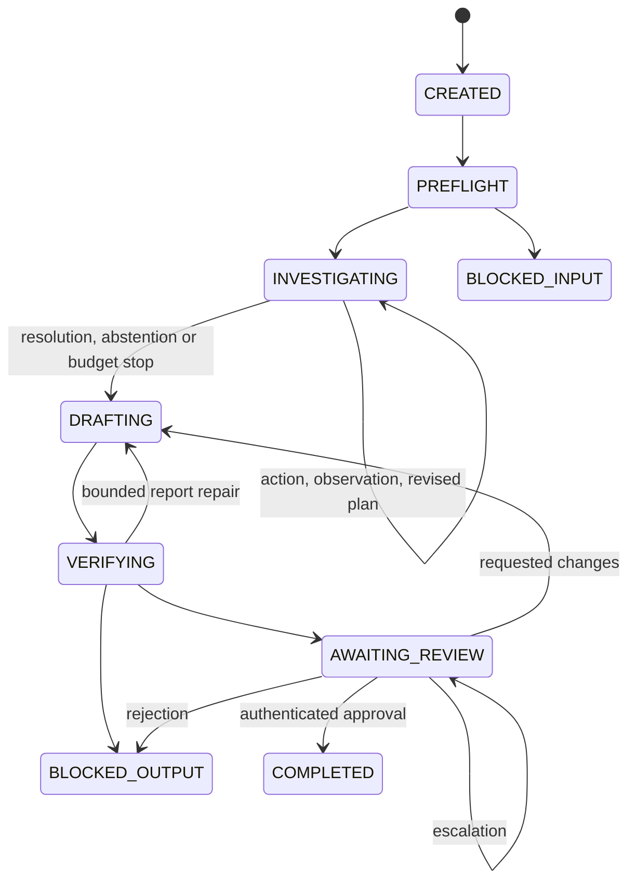

# Minimal investigation UI: implementation plan

Status: **frontend planned; backend API implemented**. This plan follows `src/recycleguard/api/app.py`, `api/store.py` and `api/trace.py`. No UI is implemented by this document. Generate client types from the running backend OpenAPI schema before implementation; the tables below describe the actual routes and request models, not a proposed replacement API.

## 1. Goal and delivery boundary

Build a local presentation interface that takes a supported synthetic producer dossier through readiness inspection, investigation, verified report and authenticated human review. A reviewer should be able to see which evidence caused a discrepancy, what the investigator requested next, what the deterministic tools established, and which claims were withheld.

The first UI uses the real intake, extraction, normalization, frozen retrieval, domain tools, report verifier and review services. The investigator's execution mode must always be visible. **Scripted demonstration** means replayed proposals with real services; it does not demonstrate model reasoning or model quality. The backend accepts `MODEL_BACKED` when a local configuration is supplied and `SCRIPTED_TEST` only with explicitly enabled test adapters and exchanges. `GET /health` reports configuration presence, not a model probe or quality acceptance (`model_probed` is false). Show local execution as an experiment until its compatibility/evaluation gate is accepted; never silently fall back to scripted proposals.

This UI does not file returns, trade certificates, certify legal compliance or calculate compensation. The investigator cannot promote source records. A separate password-authenticated support-review form may submit evidence-backed assertions through the trusted review endpoint; the backend validates and publishes a new snapshot.

## 2. Proposed screens

| Screen | Primary content | Primary actions |
| --- | --- | --- |
| Dossiers | Available dossier name, opaque ID, source, readiness, last run | Choose existing dossier; upload supported ZIP |
| Dossier readiness | Original-file inventory, extraction coverage, normalization issues, exact snapshot/profile status | Prepare draft inputs; inspect blockers; start only when authorized prerequisites are met |
| Investigation | Current stage, durable event timeline, plan revisions, bounded budgets, tool details, prompt inspector | Inspect; reconnect; request cancellation |
| Report and review | Exact report revision, deterministic balances, evidence-linked findings, verifier outcome, withheld scopes | Inspect evidence; authenticate and submit a permitted review decision |

Use a compact header with dossier, reporting year, run ID, execution-mode badge and connection state. Keep the dossier/run identity visible while opening detail panels. The initial implementation can use one route per screen with tabs or a side panel for details; it does not need a separate page for every tool call.

### Dossier selection and upload

- Offer a reliable preloaded synthetic dossier for the college demonstration.
- Upload sends raw bytes with `Content-Type: application/zip`, not multipart form data. The archive must contain exactly one `case_manifest.json` and its supported dossier assets. Limits are 25 MiB uploaded, 100 MiB declared expanded size and 500 entries. Unsafe, duplicate/case-colliding, symlink and traversal paths are rejected. This is not arbitrary PDF upload-to-database support.
- Display upload and preparation as different operations. Successful upload means bytes were accepted; successful preparation means the backend produced inspected draft inputs. Neither means the case is approved or ready for investigation.
- Show received files, rejected members, quarantined pages, unparsed fields, unresolved identifiers, source-policy restrictions and review-required observations. Preserve the original filenames and evidence locators supplied by the API.
- A PDF with a missing declared page receives a coverage warning. An unreadable or scanned page remains visible as quarantined/review required. Do not infer a missing certificate quantity or declare a dossier complete because extracted text exists.
- Do not promise automatic PDF-to-database conversion for arbitrary documents. Existing structured companion records and supported adapters determine what can be normalized. Optional OCR/VLM integration remains an explicit backend capability and does not establish reviewed facts by itself.
- `POST /prepare` produces a **foundation draft**. `POST /review-foundation` authenticates the enrolled reviewer and binds approval to `candidate_digest`, with explicit `accepted_qualifications`. An optional later `/support-review` authenticates evidence assertions against the current `snapshot_digest`. Keep foundation approval, record-support approval and final report review as three different decisions.

### Investigation workspace

The main area is an ordered timeline. The detail panel has tabs for **Decision**, **Arguments**, **Result**, **Evidence**, **Prompt** and **Audit**. Selecting a timeline entry must keep its run, turn and operation identity fixed, even if newer events arrive.

A tool entry shows:

1. Logical operation ID and individual attempt ID, tool name, finding scope and status.
2. The model's persisted concise action reason, linked plan, expected evidence and current hypothesis when available.
3. Validated arguments exactly as dispatched. User-visible JSON remains structured text; it is not executable content.
4. Structured tool result, errors and qualification. A pending allocation must never appear as supported credit.
5. Returned observations, provision locators, retrieval grades and calculation IDs.
6. Known duration, reservation and measured usage. Missing measurements display **unavailable**, not zero.

Show tool use and model calls as distinct timeline entries. One model response can propose one tool action; a tool result is not itself another model call. Retries appear under the same logical operation with separate attempt IDs and a visible retry count. Unknown completion appears explicitly and does not gain a retry button that could dispatch the same operation again.

A plan revision shows the predecessor, triggering observation/tool result, concise revision reason and new proposed checks. It must be possible to follow a weak retrieval result to the revised query and the next observation. The default view can summarize these records; expand to inspect their exact persisted contents.

### Per-call prompt inspector

The inspector is keyed by the selected **model call and attempt**, not by a single global “current prompt.” It must distinguish:

| Inspector section | What it means |
| --- | --- |
| System message | Exact system message passed to the selected adapter, when present |
| Rendered messages/request | Exact cleared request actually sent, in message order; include tool/response schemas when part of the request |
| Context | Frozen evidence identifiers and the exact included excerpts, plans, prior observations and assessments |
| Configuration | Execution mode, model configuration, prompt-template ID/digest, response schema and context-manifest ID |
| Response | Persisted structured output, validation result and output availability |
| Audit | Operation/attempt IDs and exact request/response blob digests |

`GET /agent` returns configuration: `configured`, `model_id`, `prompt_pin`, `system_template`, `phase_rules`, `response_schemas` and a note. These are **templates**, not proof of a call or exact prompt sent. `PROMPT_PREPARED` trace entries contain `request`, `phase` and a `system_template` preview; label them prepared context.

Only a completed adapter's `MODEL_RESULT.provider_trace` can establish the recorded wire payload. Its `request_body_utf8` is a JSON string; parse it and show the exact `prompt` (including system/schema/context and transport markers) plus transport parameters. The current adapter uses raw `/v1/completions`, so do not invent chat `messages`. Also expose recorded `configuration`, `endpoint`, `method`, `response_status`, `response_headers`, `response_body_utf8`, `response_body_blob` and `error` when present. Keep the untouched request text available alongside any formatted view.

`request_body_utf8: null` means there is no recorded dispatched body, for example a pre-dispatch rejection. A missing `provider_trace` means transport data is unavailable or the call was scripted. A timeout may retain a request body without a known response. None of these cases authorizes reconstructing a sent prompt from `/agent` templates.

Expose concise plans, tool-selection reasons and observation assessments already persisted by the application. Do not request, infer or display private chain-of-thought. A provider's private reasoning field must not be rendered as an explanation panel. Model output and dossier text are untrusted text: escape them, disable HTML execution, and restrict evidence navigation to API-authorized references.

Redaction occurs before model dispatch and before API exposure as required by backend policy. Never expose credentials, API authorization headers, API keys or reviewer passwords. Authorized provider traces can contain the configured local model path; display it only as recorded text, never as permission to browse arbitrary server files. A redacted preview must be labelled accordingly; do not call it byte-identical to a fuller payload.

### Budgets, cancellation and stop outcomes

Show configured ceilings beside current counts: case actions, per-finding investigative actions, model calls, token reservations, query reformulations, retries, report repairs and wall-clock limit. Keep measured tokens/cost separate from conservative reservations. Do not invent a monetary ceiling when the backend configuration has none.

The actual `POST /runs/{id}/cancel` has no request body. The server records its cancellation reason and reads the expected version internally. A `202` response with `cancellation_requested: true` means the request was accepted, not that the run is already cancelled. The worker applies it between graph turns; it does not kill or repeat in-flight inference. Keep showing **cancellation requested** until the durable state becomes `CANCELLED`. A cancelled or budget-stopped investigation must retain its available trace, partial findings and explicit stop reason.

### Verified report and authenticated review

- Display the verifier verdict separately from workflow completion and human review outcome.
- Keep target, supported quantity, pending quantity, portal figure and gap in separate columns, using exact backend decimal strings and units.
- Findings expose fact/provision references, support qualifications, scoped abstention, next action and owner when available. An unsupported refurbishment offset must not erase an ordinary AU target or block unrelated arithmetic.
- Display the report revision, input snapshots and review-dependency digest. The review form submits the exact version binding required by the backend.
- Only offer decisions listed in the current packet's permitted decisions. The possible decisions are approve, reject, request changes and escalate; their availability is a backend decision.
- Reauthenticate the enrolled reviewer using the request body's `password: SecretStr`. Credentials stay in transient input state, are cleared after submission and never enter URL parameters, browser storage, analytics, event traces or logs.
- Setup uses `POST /reviewer` with `actor_id` and `password` once. Each privileged review then supplies the password again in its JSON body. The server derives the authenticated actor and timestamp; the browser does not submit an actor capability or claim its own authentication.
- Requested changes create/revise the draft/report and require a fresh packet. A previous approval must never carry forward to changed bytes. Escalation is not approval; manual closure is not approval.

## 3. Actual API contract

All routes, including health and SSE, require `Authorization: Bearer <token>`. The configured token has at least 24 characters. Supply it through a header; never append it or a reviewer password to a URL. Keep it in session memory, with explicit reconnection after a page reload. CORS is limited to configured origins and permits `Authorization`, `Content-Type` and `Last-Event-ID` headers.

Paths in this table are relative to `/api/v1`:

| Method/path | Request body | Actual response/use |
| --- | --- | --- |
| `GET /health` | None | `status`, `model_configured`, `model_probed: false`, `concurrency: 1`, `ui_implemented: false` |
| `GET /agent` | None | Model configuration and prompt templates/schemas; no inference probe |
| `POST /reviewer` | `actor_id`, `password` | `201`, `status: ENROLLED`; local trusted reviewer setup |
| `GET /dossiers` | None | `{fixtures, dossiers}`; fixtures expose `fixture_id`, `case_id`, `fiscal_year`, `synthetic` |
| `POST /dossiers/select` | `fixture_id` | `201`; copies an allowed development fixture into a registered dossier |
| `POST /dossiers` | Raw ZIP bytes | `201`; registered `dossier_id`, `name`, `status: UPLOADED`, `synthetic`, `case_id` |
| `GET /dossiers/{id}` | None | Dossier view with `dossier_id`, `name`, `status`; prepared views also include `candidate_digest`, `foundation`, `foundation_blob` |
| `POST /dossiers/{id}/prepare` | None | Dossier view after draft preparation; reuses an existing candidate |
| `POST /dossiers/{id}/review-foundation` | `password`, `candidate_digest`, `accepted_qualifications` | Dossier view after trusted foundation approval |
| `GET /dossiers/{id}/evidence` | None | `{snapshot, records, observations, originals}` from current approved/draft foundation |
| `GET /dossiers/{id}/artifacts/{revision}` | None | Exact original bytes belonging to this dossier; declared media type, `nosniff` and sandbox policy |
| `POST /dossiers/{id}/support-review` | `password`, `snapshot_digest`, `assertions`, `reason` | Updated dossier with a new approved case snapshot |
| `POST /runs` | `dossier_id`, `mode`, optional `budgets` | `202`: `{run_id, status: QUEUED, mode}` |
| `GET /runs/{id}` | None | `{state, job}`; workflow state is separate from worker status |
| `POST /runs/{id}/resume` | None | `202`: `{run_id, status: QUEUED}` for eligible interrupted/non-stopped runs |
| `POST /runs/{id}/cancel` | None | `202`: `{run_id, cancellation_requested, note}` |
| `GET /runs/{id}/trace?after=N` | None | `{run_id, events, last_sequence}`; persisted trace projection after N |
| `GET /runs/{id}/events?after=N` | None | SSE `trace`, `stopped` and heartbeat comments; supports integer `Last-Event-ID` header |
| `GET /runs/{id}/audit` | None | Strong `VERIFIED_INTEGRITY` frozen-corpus/profile/index/ledger audit or explicit failure |
| `GET /runs/{id}/report` | None | Current `InvestigationReport`: `report`, `findings`, `available_evidence_refs`, `verification` |
| `POST /runs/{id}/packet` | None | Current version-bound review packet; run must be ready for review |
| `POST /runs/{id}/review` | `password`, `packet_id`, `expected_dependency_digest`, `decision`, `reason` | Projected durable `RunState`; requested changes schedule redrafting |

`mode` is exactly `MODEL_BACKED` or `SCRIPTED_TEST`; it defaults to `MODEL_BACKED`. Do not silently change the selection. The backend admits only one active investigation: concurrent start/resume can return `409`. A mutation lock can also return `409 BUSY` while another operation is active. These are local single-process scheduling constraints, not an invitation to start a duplicate worker.

A support assertion contains `target_record_revision_id`, a nonempty `evidence_refs` list and `reason`. Evidence references must be selected from current returned records/observations with their original locators; the browser does not manufacture support or edit source records.

The audit response must be presented separately from report verification. It verifies pinned bytes, canonical profile/source dependencies, index publication and application hash chains. It retains real limitations and caller-supplied runtime metadata. It does not establish legal correctness, model quality or full semantic support. Never replace an audit failure with the legacy `UNVERIFIED_METADATA` helper.

### Request and display examples

These are illustrative values; obtain actual IDs and digests from prior responses. Never persist or log password-bearing JSON.

```json
{"fixture_id":"case_001"}
```

```json
{"dossier_id":"dossier:returned-id","mode":"MODEL_BACKED"}
```

```json
{
  "password":"<transient reviewer input>",
  "candidate_digest":"<64-character candidate_digest from dossier view>",
  "accepted_qualifications":"Reviewed the displayed scope and unresolved authority qualifications."
}
```

```json
{
  "password":"<transient reviewer input>",
  "packet_id":"<returned packet_id>",
  "expected_dependency_digest":"<returned review_dependency_digest>",
  "decision":"APPROVE",
  "reason":"Reviewed this exact report and its stated limitations."
}
```

Frontend state types should come from OpenAPI/contract models; useful local projections are:

| UI projection | Actual source/fields | Rendering rule |
| --- | --- | --- |
| `DossierView` | `status: UPLOADED / DRAFT / APPROVED`; optional candidate/foundation fields | Approval badge is distinct from evidence completeness |
| `RunView` | `state: RunState`, `job: {run_id, dossier_id, status, detail, cancel_requested}` | Show both badges; `cancel_requested` is stored as `0 / 1` |
| `JobStatus` | `QUEUED / RUNNING / STOPPED / FAILED / INTERRUPTED` | STOPPED can mean awaiting human review, not successful completion |
| `TracePage` | `run_id`, `events`, `last_sequence` | Merge by event ID/sequence, preserve order |
| `TraceEvent` | `sequence`, `event_id`, `operation_id`, `event_type`, `payload_ref`, `kind`; kind-specific fields | Discriminate on `kind`; do not assume all entries contain `data` or `provider_trace` |
| `ProviderTrace` | Recorded transport strings/status/headers/blob/error | Exact wire body is a retained string, not a re-rendered template |
| `ReviewPacket` | `packet_id`, `report_revision_id`, `review_dependency_digest`, `input_snapshot_refs`, `permitted_decisions` | Submit digest and packet together; re-fetch after changes |

Trace kinds are `PROMPT_PREPARED`, `PLAN`, `TOOL_PROPOSED`, `ASSESSMENT`, `MODEL_RESULT`, `TOOL_OR_STAGE_RESULT` and `AUDIT`. Render `TOOL_PROPOSED.data.concise_reason` as the model's concise action reason. Tool/stage `data` is the outcome envelope, while `result` is the dereferenced structured service output when present. The response envelope and `exact_response` are separate from `provider_trace` transport data. The current projection does not expose an attempt ID on every generic event; use recorded IDs where supplied and do not manufacture a missing one.

## 4. State and navigation

```mermaid
flowchart LR
    Choose[Choose or upload dossier] --> Inspect[Inspect files and readiness]
    Inspect --> Prepare[Prepare draft inputs]
    Prepare --> Approval[Await trusted input approval]
    Approval --> Ready[Approved inputs ready]
    Ready --> Start[Start explicit execution mode]
    Start --> Run[Investigation and trace]
    Run --> Report[Verified report and qualifications]
    Report --> Review[Authenticated human review]
    Review --> Closed[Committed outcome]
```



Preparation can produce issues that return the user to inspection. The implemented `/review-foundation` and `/support-review` routes authenticate separate trusted input decisions; neither is final report approval.



This is a navigation aid, not an exhaustive transition specification. Render all eleven `RunStatus` values, including `FAILED` and `CANCELLED`, directly from backend state. Errors, cancellation and manual closure can stop eligible stages; the UI must not synthesize transitions. `COMPLETED` alone does not explain the human decision, so always show the separate review outcome and stop reason.

## 5. Events, reconnects and errors

Use SSE only to update a read-only projection. It must not trigger graph dispatch from the browser. The backend worker advances the graph; `GET` requests do not advance it.

Native `EventSource` cannot set the required bearer header. Implement streaming with authenticated `fetch()` and a streaming SSE parser, or an equivalent client that supports headers. Pass `Authorization` and, on reconnect, integer `Last-Event-ID`; never move the credential to a query string. Use an abort controller when switching runs. Allow chunk splits within JSON, lines and UTF-8 characters; parse complete SSE frames rather than each network chunk as JSON.

1. Fetch `/runs/{id}` and `/trace?after=0`, render existing events and remember `last_sequence`. Subscribe to `/events?after=<last_sequence>`; the server replays later durable events, avoiding the snapshot/subscription gap.
2. `trace` frames contain `id: <sequence>` and one projected event. Advance the cursor only after successfully applying the frame. Deduplicate by stable event ID or `(run_id, sequence)`, not merely operation ID.
3. The cursor is a run-stream integer, not a child-service sequence or timestamp. Child operation references inside service results remain lineage; they do not introduce another cursor space to this endpoint. When both query and header cursors are supplied, the backend uses their maximum. Noninteger `Last-Event-ID` is rejected with `422`.
4. Ignore `: heartbeat` comments. `stopped` frames contain the **job** object without a new trace ID. Refresh `/runs/{id}`, trace and report availability; do not translate a stopped worker to `COMPLETED`.
5. On disconnect, retain the trace, show reconnecting and resume from the last applied sequence. If a cursor/schema mismatch is suspected, refetch trace from zero and rebuild the projection. Do not fabricate missing operation results.
6. API restart marks queued/running jobs `INTERRUPTED`. Read the durable workflow state before exposing explicit `/resume`. The API rejects resume for awaiting-review/terminal states; use review actions there. Reload/second tab must never automatically repeat start, review or cancel mutations.
7. `POST /runs` has no client idempotency-key field and `/runs` listing is not implemented. Disable duplicate start clicks. If its response is lost before obtaining `run_id`, show unknown request outcome and require backend reconciliation; do not automatically resubmit. For known run IDs, resolve cancel/review ambiguity by reading current state and packet/trace.

| Condition | UI response |
| --- | --- |
| Unsupported or rejected ZIP/member | Keep the selected package visible; show backend member-specific errors; do not show “ready” |
| Missing extraction/approval | Show exact readiness blockers and required next action; prevent unsupported start |
| Validation error | Show field-level errors returned by the API and retain non-sensitive form values |
| Stale state/report/packet | Reload current state and revision; require the human to inspect changes before another submission |
| Authentication failure | Clear credentials; retain report context; permit reauthentication without duplicating a decision |
| Unknown operation outcome | Show committed unknown status and available operation ID; query status/trace; never automatically retry a mutation |
| Timeout/disconnect after start, cancel or review | Resolve the request using documented idempotency/status lookup before offering another submission |
| Model unavailable/schema failure | Show explicit model-call failure/abstention and stop reason; do not substitute another mode |
| Missing evidence/index integrity failure | Expose the failure and preserved trace; rely on backend immutable recovery rather than rebuilding evidence in the browser |

The actual API uses `401` for a missing/wrong bearer, `404` for missing catalogue resources, `409` for preconditions or busy work, `413` for oversized upload, `415` for upload content type, and `422` for request/archive validation. Error envelopes differ: framework errors use `detail`, while validation/value/key handlers return `code` with `errors` or `message`. Normalize these for display without discarding the original diagnostics or echoing request credentials. Frontend validation never substitutes for backend checks.

## 6. Implementation sequence after backend approval

1. **Capture the implemented contract.** Generate types from backend OpenAPI and inspect real responses using the API tests/demo. Confirm the deliberate absence of start idempotency/run listing, single-worker scheduling, integer replay cursor and password-body authentication. Keep template/prepared/wire prompt layers distinct.
2. **Create the minimal frontend shell.** Choose the smallest suitable stack after inspecting the repository's tooling at implementation time. Keep typed API access, screens and event projection separate; do not duplicate reconciliation or review rules in UI code. Use the backend's approved browser origin/authentication setup. Bind the development server to `0.0.0.0` only when it must be reachable externally; explicit backend access controls still apply.
3. **Build dossier/readiness first.** Connect list, details, ZIP upload and preparation. Demonstrate supported structured input and a deliberately incomplete PDF. Wire reviewer enrollment, foundation approval and support review as separate forms with exact digest checks.
4. **Connect start and run state.** Add explicit mode selection and version-aware cancellation. Verify repeated clicks/reload cannot dispatch duplicate runs. Keep missing real-model readiness visible.
5. **Add SSE and trace inspection.** Build stable operation/attempt rows, plan revisions, budgets, argument/result panels and evidence links. Exercise disconnect/replay before adding decorative animation.
6. **Add exact prompt inspection.** Render only retained request data, with separate system/messages/schema/context sections and clear scripted/adapter/unavailable labels. Verify redactions and HTML escaping.
7. **Connect verified reports and review.** Bind the form to the current packet/report/inputs, reauthenticate, submit one decision and display the committed projection. Exercise stale-packet rejection and requested-changes round trips.
8. **Verify the complete college demonstration.** Run backend and frontend together using the same known dossier, capture an inspectable trace and verify the stored report/review outcome independently of what the screen displays. Only then polish layout and prepare the presentation sequence.

Backend API approval permits preparing this plan; it does **not** authorize building the frontend now. Frontend implementation starts after its scope and backend contract are accepted.

## 7. College demonstration and acceptance checks

The dependable demonstration selects a preloaded synthetic fixture and prepares/reviews it through the actual API, or opens an already registered approved dossier. An optional short upload segment shows the supported package and readiness issues. It does not depend on arbitrary PDF extraction or a live model download during the presentation.

Suggested demonstration sequence:

1. Show the dossier, reporting year, original evidence and frozen input readiness.
2. Start the explicitly labelled mode. For scripted mode, explain that the service integration is real and the proposals are replayed.
3. Open a model call's recorded request and its concise tool-selection reason.
4. Follow a weak retrieval result into a revised plan/query, then inspect a deterministic reconciliation result and its source references.
5. Explain supported versus pending quantities and an explicit scoped abstention.
6. Open the verified report, authenticate as the enrolled reviewer and record a permitted decision bound to that report version.

Acceptance requires meaningful end-to-end checks, not just component rendering:

- Supported package upload, preparation and draft readiness work; unknown PDFs and incomplete coverage do not gain fabricated normalized facts.
- The displayed mode matches the persisted run mode; unavailable local-model compatibility cannot become a hidden scripted fallback.
- Timeline operations, attempts, plan revisions and counts match backend trace records; reconnect/reload creates neither missing entries nor duplicated dispatch.
- The prompt inspector matches the retained per-attempt payload/digests or explicitly says which layer is unavailable. It never fabricates system messages or exposes credentials/private reasoning.
- Evidence navigation reaches the exact authorized original observation/provision locator. Untrusted text cannot execute HTML or authorize a tool.
- Reconciliation values and units match backend decimal strings; pending credits are not subtracted as supported fulfilment.
- Cancellation, budget exhaustion and unknown outcomes preserve trace and stop according to backend state.
- Review rejects wrong credentials, stale versions and reused packets; requested changes require fresh report/packet bindings.
- Windows and macOS development paths use the same API contract. Existing Linux/Windows backend CI remains required; frontend build/browser checks are added when the frontend exists.

Remaining frontend decisions: stack/build tooling, responsive layout, client schema generation, session-memory credential UX and exact trace/evidence rendering. Backend additions such as start idempotency, a run-list route or multi-worker execution are separate scope; the frontend must not assume they already exist.


## 8. Planned frontend components and integration boundaries

No components below are implemented yet. Keep API access and event projection outside presentational components.

| Planned component/module | Responsibility |
| --- | --- |
| `ApiSession` / `ApiClient` | Session-memory bearer, header injection, JSON/error normalization; password bodies are never logged |
| `DossierPicker` / `ZipUpload` | Distinguish fixture selection from registered dossiers; raw ZIP validation/progress |
| `FoundationReadiness` | Show candidate digest, preparation counts/issues and separate approval state |
| `ReviewerSetup` / `FoundationReviewForm` | Enrollment and candidate-bound review with transient password input |
| `EvidenceBrowser` / `SupportReviewForm` | Original/observation/record links and explicit supported assertions against current snapshot digest |
| `RunLauncher` / `RunStatusBar` | Explicit mode/budgets, one-active-run conflict, separate state/job badges |
| `TraceStore` / `AuthenticatedSseClient` | Ordered deduplicated projection, reconnect cursor, abort-on-navigation and stopped frames |
| `ToolTimeline` / `PlanRevisionPanel` | Actual concise reasons, checked arguments/results, revisions, budget/stop outcomes |
| `PromptInspector` | Tabs for templates, prepared context, exact provider transport and structured response; explicit unavailable states |
| `EvidenceViewer` | Authenticated artifact fetch, returned media type, safe locator display and sandboxed rendering |
| `VerifiedReport` / `ReviewDecisionForm` | Report verifier outcome, scoped abstention, current packet and exact dependency digest |
| `IntegrityAuditPanel` | Strong `/audit` status, checked pins/streams and retained limitations; explicit failures |

Artifact requests also need the bearer header. Fetch bytes through `ApiClient` before creating a temporary browser object URL; do not put credentials in an iframe/PDF URL. Revoke object URLs on unmount. Render JSON/text as escaped text and PDF content in a restricted viewer; preserve sandboxing when moving fetched bytes into a browser-owned viewer. Do not execute uploaded HTML/JavaScript or turn server paths into file-browser links.

The minimum browser integration test should select a real fixture, prepare it, enroll/authenticate a reviewer, approve the foundation, inspect evidence, start an explicitly supported run mode, reconnect the SSE stream, inspect exact available prompts/tool results, open the verified report and strong audit, request a packet and submit a bound decision. Include stale-digest rejection, one-active-run `409`, invalid bearer, malformed ZIP, unknown provider outcome and cancellation between turns. Cross-check the displayed state and trace against subsequent API reads; do not count a successful HTTP response or a stopped job alone as a completed investigation.
