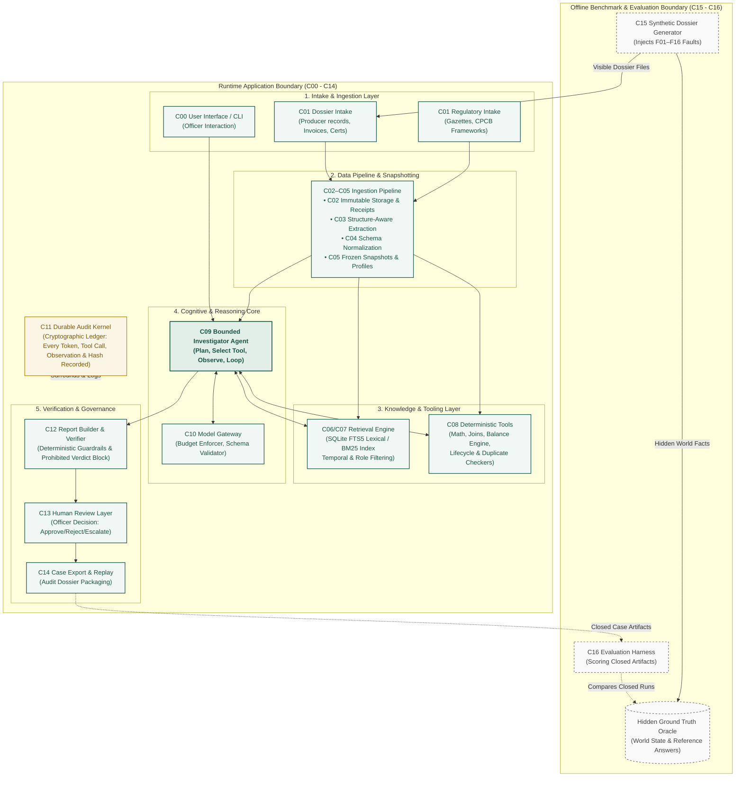
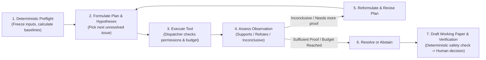

# ReCycleGuard: System Design Summary (Review 2)

> **Document Reference:** `REVIEW_2_DESIGN.pdf` / `docs/design/REVIEW_2_DESIGN.tex`  
> **Project:** ReCycleGuard — Agentic AI for E-Waste EPR Compliance Reconciliation  
> **Course / Academic Review:** B.E. CSE (Data Science), VII Semester, BMSCE (Review Date: 24 October 2026)  
> **Team:** R V Abhishek (Lead), H Sampreeth Bhat, Sushanth S, Vedantha Vinay Vernekar  
> **Supervisor:** Dr. Kalyan Nagaraj  

---

## Executive Overview

**ReCycleGuard** is an agentic decision-support system designed to assist environmental compliance officers in reconciling **Extended Producer Responsibility (EPR)** e-waste records under **India’s E-Waste (Management) Rules, 2022** and subsequent amendments.

Instead of attempting fully autonomous legal filing or simple keyword matching, ReCycleGuard answers one primary operational question:
> **"Which discrepancy should the compliance officer investigate next, and what verification or correction does the available evidence actually support?"**

The system produces a transparent, evidence-backed working paper containing deterministic calculations, statutory citations, explicit uncertainty boundaries, and designated human action items.

---

## 1. System Architecture & Data Flow

ReCycleGuard runs as **one local Python application** structured into modular components (designated `C00` through `C16`). It deliberately decouples the **runtime operational pipeline** (`C00`–`C14`) from the **offline evaluation harness and oracle** (`C15`–`C16`), guaranteeing that ground-truth evaluation answers are strictly inaccessible to the agent during runtime.

### 1.1 Architecture Diagram

### 1.2 Step-by-Step Data Flow

1. **Intake (`C01`):** Official statutory gazettes and producer documentation (sales ledgers, recycler credits, weight tickets) are ingested.
2. **Immutable Storage & Normalization (`C02`–`C05`):** Raw files receive unique cryptographic hashes and receipts. Text and tables are extracted while preserving exact cell, row, and footnote locators. Data is normalized into frozen, immutable snapshots.
3. **Deterministic Preflight (`C08`):** Python-based tools calculate initial baseline arithmetic balances, spot duplicate records, and surface raw numerical differences.
4. **Agentic Investigation Loop (`C09` $\leftrightarrow$ `C10`):** The agent reviews unresolved discrepancies, formulates an investigative plan, executes specialized retrieval (`C07`) or calculation tools (`C08`), checks observations, and updates findings in a feedback loop.
5. **Deterministic Verification (`C12`):** A rule-based verifier confirms that all numbers in the report agree with the code engine and strips out any unsupported legal conclusions or hallucinated fraud accusations.
6. **Human Decision (`C13`):** An authorized human officer reviews the evidence-backed draft, making the final binding decision to Approve, Reject, Request Changes, or Escalate.

---

## 2. Chosen Agentic Patterns and Justification

The design avoids a simple single-shot RAG (Retrieval-Augmented Generation) or an unstructured autonomous agent. Instead, it combines six complementary patterns:

| Pattern | Architectural Implementation | Why It Was Chosen Over Alternatives |
| :--- | :--- | :--- |
| **1. Tool Use (Deterministic Operations)** | Encapsulated in `C08`. Exact joins, unit conversions, decimal arithmetic, and lifecycle checks run strictly via Python code. | **LLMs are unreliable calculators.** By forcing math into deterministic code using string-based `Decimal` precision, ReCycleGuard eliminates numerical hallucinations completely. |
| **2. Agentic RAG (Dynamic Retrieval)** | Implemented in `C07`. The agent actively constructs targeted queries, assesses statutory authority, and refines searches based on missing data. | **Statutory interpretation is non-linear.** Static RAG dumps irrelevant legal chunks into context. Agentic RAG dynamically retrieves only the relevant schedule, vintage rule, or amendment for the specific item under review. |
| **3. Planning & Reflection** | Implemented in the `C09` investigation cycle (Stages 2–5). Each action records an explicit plan, expected findings, and stopping conditions. | **Complex investigations require course-correction.** If a search yields inconclusive evidence, the agent reflects on the gap, revises its hypothesis, and picks another tool rather than making a wild guess. |
| **4. Human-in-the-Loop Review** | Implemented in `C13`. Cryptographically binds human approvals or change requests to specific report hashes. | **High legal stakes.** Automated filing or autonomous fraud declaration creates statutory liabilities. Humans must retain final legal accountability; the agent acts strictly as an investigative copilot. |
| **5. Durable State & Checkpointing** | Implemented using LangGraph checkpoints and SQLite audit storage (`C11`). | **Fault tolerance and full auditability.** Every state transition, tool input, and output is saved. If an external API or network connection drops, the investigation resumes from the exact previous state without losing context or wasting tokens. |
| **6. Bounded Single Agent (with Optional Multi-Agent Experiment)** | Single investigator in v1; optional Collector/Auditor separation in evaluation (`D`). | **Avoids unnecessary coordination overhead.** Multi-agent architectures introduce latency, token bloat, and communication breakdowns. A bounded single agent with strict tools solves the task efficiently; multi-agent is treated as a controlled experiment, not a dogma. |

### The Investigation Feedback Loop (How the Agent Investigates)

---

## 3. Data Sources & Tool Plan

### 3.1 Authoritative Data Sources

The project enforces strict separation between **official statutory law** and **empirical producer evidence**:

1. **Normative Statutory Corpus (The Law):**
   * *Primary Legislation:* Ministry of Environment, Forest and Climate Change (MoEFCC) **E-Waste (Management) Rules, 2022** (G.S.R. 801(E), commencing 1 April 2023).
   * *Statutory Amendments:* E-Waste Amendment Rules, 2024 (G.S.R. 164(E), inserting Rule 9A).
   * *Regulatory Frameworks:* Central Pollution Control Board (CPCB) Framework for Generation of EPR Certificates & Annexure I.
   * *Operational Guidelines:* Official CPCB Frequently Asked Questions (FAQs), standard operating procedures (SOPs), and conversion rate circulars.
   * *Preservation Rule:* Raw PDF bytes, exact gazette notifications, commencement dates, and provision paths are kept separate. Amendments do not overwrite original gazettes; both versions are retained to maintain chronological integrity.

2. **Producer Dossiers (Case Evidence):**
   * Structured synthetic manifests, sales ledgers, quarterly obligation targets for four metal categories (Gold, Copper, Aluminium, Iron), third-party recycling certificates, bank payment slips, and portal account snapshots.

### 3.2 Structure-Aware Ingestion Pipeline

To prevent data loss:
* Extraction tracks page numbers, headings, table rows, and cell locators.
* OCR results and file parsing anomalies receive explicit status receipts (`PARSED`, `QUARANTINED`, `EXCLUDED`, or `UNAVAILABLE`).
* **Rule of Evidence:** A corrupted file or unreadable receipt is treated as *unreadable evidence*, never as *zero business transactions*.

### 3.3 Core Tool Plan (`C07` & `C08`)

Every tool adheres to the versioned `CONTRACTS.md` protocol, returning a standardized `ServiceResult<T>` containing operational status, complete payload, explicit issues, and full provenance locators.

| Tool Name | Module | Input Parameters | Output & Purpose |
| :--- | :--- | :--- | :--- |
| `inspect_evidence` | `C08` (Code) | Artifact ID, observation ID, or scoped record reference. | Retrieves raw and parsed document values with exact page/row provenance; handles missing records without crashing. |
| `resolve_locator` | `C07` (RAG) | Legal provision path, source version, applicability year, expansion policy. | Retrieves exact statutory clauses, parent headings, and footnotes from SQLite FTS5 index; validates temporal applicability. |
| `trace_certificate` | `C08` (Code) | Certificate number, batch reference, case identifier. | Reconstructs the complete lifecycle of a recycling credit: generation, transfer, splitting, and prior redemptions. |
| `compute_reconciliation` | `C08` (Code) | Target metal buckets (Au/Cu/Al/Fe), active allocations, snapshot digest. | Calculates exact balance: $\text{Required} - \text{Supported} = \text{Gap}$. Tracks pending items separately; ensures non-negative numbers and exact string decimals. |
| `compare_return_draft` | `C08` (Code) | Draft return sections, calculation IDs, filing deadline records. | Flags missing schedule sections, unfulfilled metal targets, and deadline discrepancies prior to human review. |

### 3.4 Governance & Safety Budgets

To keep the agent bounded, secure, and cost-effective:
* **Action Budget:** Maximum **8 tool calls per discrepancy finding**, at most **2 query reformulations**, and **1 report repair attempt**.
* **Zero Prohibited Verdicts:** The verifier (`C12`) automatically rejects draft reports that attempt to declare legal compliance, allege intentional fraud or criminal concealment, or estimate legal compensation fines. The agent is an investigator, not a judge.
* **Code Sandbox:** The model is strictly barred from running arbitrary SQL, executing shell commands, or accessing outside networks.

---

## 4. Evaluation Plan & Quality Metrics

ReCycleGuard adopts an experimental framework using a controlled, offline evaluation harness (`C16`) isolated from the agent runtime.

### 4.1 Evaluation Dataset: 48 Synthetic Dossiers

The benchmark includes **48 carefully designed synthetic test cases** (24 development cases and 24 held-out test cases). Rather than splitting rows randomly, cases are stratified across a comprehensive **16-fault taxonomy (`F01` to `F16`)**:

* **Clean Scenarios:** `F01` (Clean, fully compliant baseline).
* **Data & Lifecycle Anomalies:** `F02` (Overlapping exports/duplicate observations), `F03` (Multi-stage lifecycle ID reuse), `F04` (Unit/dimension mix-up, e.g., kg vs. MT), `F05` (Entity aliases & trade name variations), `F06` (Stale account balance snapshots), `F07` (Paid commercial invoice without valid certificate transfer), `F08` (Unsettled historical liabilities/prior arrears), `F09` (Expired or revoked recycling certificates).
* **Regulatory & Statutory Edge Cases:** `F10` (Recycler capability mismatch, e.g., recycling non-ferrous metals without required permit), `F11` (Applying wrong-period rules or obsolete circulars), `F12` (Unseen CPCB clarification notices), `F13` (Gross vs. net metal weight basis discrepancies), `F14` (Unsupported recycling regime claims).
* **System Robustness:** `F15` (Extraction loss/corrupt page handling), `F16` (Adversarial prompt injection embedded in supplier invoices).

### 4.2 Comparative Baselines

Every test dossier is evaluated across four distinct configurations:
1. **System A (Deterministic Baseline):** Traditional rule-based join and subtraction scripts without LLM or RAG.
2. **System B (Static RAG + Tools):** Fixed prompt retrieval with single-shot tool execution.
3. **System C (Bounded Investigator - Proposed v1):** Dynamic investigation loop, adaptive retrieval, and deterministic verification.
4. **System D (Multi-Agent Experiment):** Split roles with dedicated Collector and Auditor agents.

### 4.3 Evaluation Metrics

| Metric Category | Metric Name | Definition & Acceptance Target |
| :--- | :--- | :--- |
| **Arithmetic Integrity** | **Exact Balance Agreement** | Percentage of metal obligation buckets that match the ground-truth decimal reference exactly. **Target: 100% (Zero tolerance for math errors).** |
| **Discrepancy Detection** | **Precision & Recall** | $\text{Precision} = \frac{\text{True Discrepancies Flagged}}{\text{Total Flagged}}$, $\text{Recall} = \frac{\text{True Discrepancies Flagged}}{\text{Total Injected Faults}}$. Clean cases (`F01`) evaluate false alarm rates. |
| **Epistemic Honesty** | **Resolution & Abstention Rate** | The model's ability to resolve issues where evidence exists, and **explicitly abstain** when evidence is missing. Guessing hidden facts is penalized. |
| **Legal Grounding** | **Citation & Temporal Correctness** | Ratio of statutory citations that directly support the claim and apply to the correct fiscal year, role, and jurisdiction. |
| **Safety & Policy** | **Unsupported / Prohibited Rate** | Frequency of unsupported factual claims or forbidden verdicts (e.g., declaring "fraud"). **Hard Target: 0.0% in released reports.** |
| **Efficiency** | **Steps, Latency & Cost** | Mean tool actions per investigation, p50/p95 latency (in seconds), and token cost per dossier. |
| **Audit Completeness** | **Audit Coverage** | Percentage of tool operations, model turns, and transformed rows with full cryptographic hash lineage. **Target: 100%.** |

### 4.4 Hard Acceptance Gates

Before any version of ReCycleGuard is accepted:
1. **Deterministic calculations must match ground truth with zero variance.**
2. **Audit coverage must be 100% complete across all processed documents.**
3. **Zero prohibited verdicts or accusations may appear in generated reports.**
4. **When evidence is inconclusive, the system must produce a structured escalation rather than a speculative guess.**

---

## Summary of Responsibilities & Roadmap

* **R V Abhishek (Lead):** Core integration, contracts, and investigator agent (`C00`, `C09`, `C10`).
* **H Sampreeth Bhat:** Regulatory sources, temporal validity, and retrieval engine (`C01`, `C05`, `C06`, `C07`).
* **Sushanth S:** Extraction, normalization, calculation engines, and reference fixtures (`C03`, `C04`, `C08`, `C15`).
* **Vedantha Vinay Vernekar:** Storage, audit kernel, human review interface, and evaluation harness (`C02`, `C11`, `C12`, `C13`, `C14`, `C16`).
