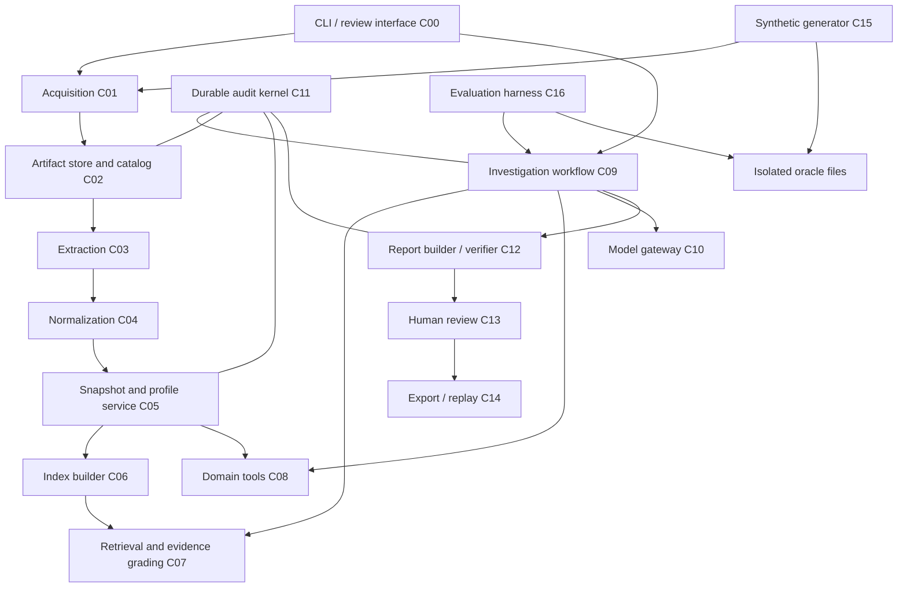
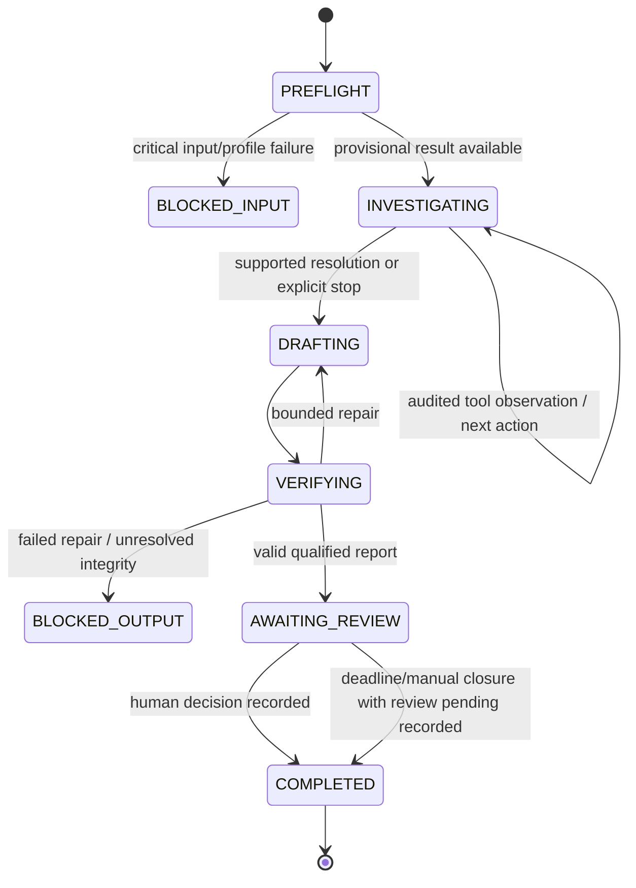

# ReCycleGuard system design

**Version:** 1.0 — 18 October 2026.

**Status:** Implementation specification; components and datasets described here are planned, not already built.

**Final consistency review:** 19 October 2026.

**Interface authority:** [CONTRACTS.md](CONTRACTS.md) defines boundary types, validation and protocol behavior. This document defines architecture, storage, algorithms and acceptance criteria.

## 1. Design basis and decisions

The repository currently contains documents, not an application or dependency manifest. This design builds on the [project charter](../../PROJECT_CHARTER.tex), [course requirements](../../PROJECT_GUIDELINES.md), [domain workflow](../research/DOMAIN_RESEARCH.md), [implementation overview](../research/AGENTIC_IMPLEMENTATION_OVERVIEW.md) and the newly supplied [CPCB EPR data and RAG research](../research/CPCB%20EPR%20Data%20and%20RAG.md).

### 1.1 Product boundary

Given a bounded producer dossier and frozen regulatory knowledge, support one decision: **which discrepancy requires investigation next, and what evidence supports the proposed verification or correction?** Produce a traceable working paper for a human reviewer. No live CPCB filing, credit purchase, OTP interaction, autonomous legal certification or compensation assessment.

The first calculation profile, `producer_snapshot_v1`, uses one fictional producer, FY 2024–25, supplied metal-wise obligation statements and explicit historical-liability buckets. Select up to two **specific reviewed EEE codes**, not category families such as “ITEW” alone. Support separate Au/Cu/Al/Fe quantities where supplied; gold is supported only as a supplied fixed obligation bucket, with gold-specific adjustments rejected as unsupported. Do not independently derive statutory targets from sales in v1.

The 48-dossier benchmark is a pilot target, not an existing dataset or a validated sample size. A rule profile cannot be published as legally reviewed until a named reviewer has approved its provenance and tests.

### 1.2 How the new research is adopted

| Research proposal | Design disposition |
| --- | --- |
| Separate normative sources, operational dossiers and hidden evaluation truth | Adopt as distinct storage/access domains. |
| Preserve raw files, source locators, decimal quantities and three timestamps | Adopt; extend with observation/event separation and version-specific lineage. |
| Structure-aware retrieval with amendment relationships and evidence grading | Adopt; lexical baseline first, optional dense candidate search with the same contract. |
| Hash certificate ID + stage + timestamp as event identity | Insufficient by itself: distinct transfers can share these values. Preserve observations and require authoritative event IDs or reviewed equivalence assertions. |
| Integer authority rank decides precedence | Use source class for screening; never resolve legal conflicts from an integer alone. Applicability is clause-specific and reviewed. |
| Fixed 0.95 OCR confidence cutoff | Configurable extraction policy; engine scores are not universally calibrated probabilities. Critical identifiers require deterministic validation or human confirmation. |
| XML wrapping/stripping neutralizes prompt injection | Wrapping is a presentation aid. Restricted tools, schema validation and access controls enforce the boundary; preserve original malicious text as evidence. |
| Fixed GST rate, EPR price range, denomination list or solar-target percentages | Do not hard-code from the research summary. Preserve observed values; activate a check only with a reviewed source-backed profile. Tax/pricing/solar calculations are outside v1. |
| All private data is unpublishable; no public transaction dataset exists | Retain the narrower finding: none was verified in the research. Access and publication depend on actual permission/rights. |
| Gazette/manual redistribution labels | Store per-asset legal basis and reviewer decision; no automatic rights grant based on host or file type. |
| Dense retrieval is necessarily better | Treat as an experiment. No embedding model or vector service selected without measurement. |

The uploaded research remains unchanged. This table records deliberate qualifications so implementation does not accidentally convert tentative research into irreversible assumptions.

### 1.3 Non-negotiable invariants

1. Every submitted file receives a receipt before parsing, even if corrupt, irrelevant, duplicated or never shown to the model.
2. Originals and extracted observations are immutable; corrections create revisions and explicit lineage.
3. A run pins exact case, corpus, profile, index, prompt, code and policy versions. “Latest” is never a replay dependency.
4. Every source row/page is accounted for as parsed, quarantined, deliberately excluded or unavailable. Zero parsed rows must not mean zero business activity.
5. Money, equipment mass and individual metals are distinct dimensions. Exact decimals cross all interfaces as strings; no binary-float totals.
6. One physical event can have many observations; one certificate can have many events. Neither is deduplicated by certificate ID alone.
7. Full permitted inputs/results are retained independently of model context selection. Logs are not limited to cited evidence.
8. Hidden world truth and oracle labels are inaccessible to the investigator, retrieval index, model prompts and review UI.
9. No business action or run transition succeeds without a durable audit record. Audit/storage failure stops progress.
10. Missing evidence, unsupported rules and unresolved contradictions remain explicit. No assumption fills an evidential gap silently.

## 2. Architecture and component boundaries

Build a **single local Python application with logical modules**, not distributed microservices. A Typer CLI is the first entry point; a small read/review web interface can reuse the same services. Proposed stack: Python 3.11+, uv, Pydantic v2, stdlib `sqlite3`/`decimal`, LangGraph and PDF text/table extraction. Use pandas only for convenient tabular operations, preserving decimal objects or decimal strings. Pin compatible dependency versions in `uv.lock` during implementation.

SQLite FTS5 provides lexical indexing and BM25 ranking; verify FTS5 support at startup. LangGraph persists resumable workflow checkpoints, while the application's database owns evidence, domain decisions and audit events. Pydantic boundary validation and explicit decimal serialization prevent implicit representation changes. References: [SQLite FTS5](https://www.sqlite.org/fts5.html), [LangGraph persistence](https://docs.langchain.com/oss/python/langgraph/persistence), [Pydantic serialization](https://docs.pydantic.dev/latest/concepts/serialization/).



Audit applies to **all components**, including acquisition, failed parsing, retrieval, model traffic, reviewer decisions and exports; diagram edges are abbreviated for readability. C15 submits only its visible dossier to C01. C16 runs the investigator in an isolated environment before accessing oracle data for scoring.

| Component | Responsibility | Authoritative outputs |
| --- | --- | --- |
| C00 Interface | Validate commands, supply actor/context, display full case coverage and review state | Command receipts; no direct database edits |
| C01 Acquisition | Register discovery leads and fetch/import permitted files | Acquisition attempts, received-asset receipts |
| C02 Artifact catalog | Immutable bytes, hashes, rights/access classification, artifact lineage | Blob references, artifact revisions |
| C03 Extraction | Explicit CSV/JSON/PDF adapters, OCR fallback, page/row accounting | Extraction revisions, observations, coverage ledger |
| C04 Normalization | Validate known schemas, units, identity mappings, event equivalence | Typed records, links, exceptions; originals untouched |
| C05 Snapshots/profiles | Freeze case/corpus membership and reviewed calculation/applicability configuration | Content-addressed snapshots and immutable profiles |
| C06 Index | Build reproducible lexical and optional dense indexes over eligible corpus membership | Index manifest, searchable clause/table rows |
| C07 Retrieval | Filter, rank, expand related clauses, grade evidence, retain candidate dispositions | Retrieval attempts and evidence bundles |
| C08 Domain tools | Deterministic lifecycle analysis, allocation, matching, balances and comparisons | Versioned calculation results and fact references |
| C09 Workflow | Bounded plan–act–observe loop, checkpoints and escalation | Run states, action choices, findings |
| C10 Model gateway | Sole model/embedding-provider access; exact request/response capture | Validated responses, usage and provider-error records |
| C11 Audit | Durable event order, commit protocol, operation idempotency and integrity checks | Append-only event ledger and turn manifests |
| C12 Reports | Structured claims, deterministic numerical rendering, citation checks | Immutable report and verification result |
| C13 Review | Version-bound human decisions and amendments | Review records, never simulated filing receipts |
| C14 Export/replay | Complete local audit packages, policy-filtered public packages, replay | Bundle manifests, exclusions and verification receipts |
| C15 Generator | Seeded world generation, visible rendering and fault injection | Visible datasets and separately protected truth |
| C16 Evaluation | Baselines, isolation, independent expected calculations and metrics | Trial records, scores and reproducibility manifests |

## 3. Storage architecture

### 3.1 Formats and physical layout

All paths below are **planned**, relative to a configurable `RECYCLEGUARD_DATA_ROOT` outside tracked source by default. The repository stores code, schemas, source discovery manifests and publication-cleared synthetic assets; operational runtime data stays in an ignored local directory.

```text
recycleguard/                         # proposed repository additions
  src/recycleguard/                   # logical component modules
  schemas/v1/                        # generated JSON Schemas + sample fixtures
  config/                            # non-secret policies and CLI defaults
  data/source_catalog.jsonl           # public metadata; no invented file hashes
  data/synthetic/public/             # release-cleared visible benchmark only
  tests/                             # contract, calculation, recovery tests
  docs/design/                       # this design and contracts

<RECYCLEGUARD_DATA_ROOT>/
  objects/sha256/<prefix>/<digest>    # exact bytes, including permitted originals
  registry/runtime.sqlite            # authoritative application/catalog/audit DB
  workflow/checkpoints.sqlite        # rebuildable workflow continuation state
  indexes/<index_id>/                 # FTS/dense derived index + manifest
  exports/<bundle_id>/                # local/export staging, never source authority
  staging/<operation_id>/             # incomplete writes only

<SEPARATE_BENCHMARK_TRUTH_ROOT>/
  <dataset_version>/world.jsonl
  <dataset_version>/corruptions.jsonl
  <dataset_version>/oracle.jsonl
  <dataset_version>/generation_manifest.json
```

Store original PDFs/HTML/CSV/images **as original bytes**; extracted structured data as UTF-8 JSONL plus page text; normalized entities and relations in SQLite; reports as JSON plus deterministic Markdown/HTML; full provider/tool payloads as JSON blobs; manifests as canonical JSON. CSV is an interchange format, not the source of canonical type semantics. FTS/vector files and graph checkpoints are derived and reproducible from frozen inputs.

A content hash identifies bytes, **not access permission**. The catalog also records case/tenant membership, sensitivity and rights. Different users may reference identical bytes without gaining each other's metadata or access.

### 3.2 Authoritative tables and ownership

| Table family | Main records and links | Writer |
| --- | --- | --- |
| Acquisition/catalog | `source_leads`, `fetch_attempts`, `artifacts`, `artifact_revisions`, `artifact_access`, `rights_decisions` | C01/C02 through C11 transactions |
| Extraction | `extractions`, `coverage_items`, `observations`, `extraction_issues` | C03 |
| Knowledge | `source_versions`, `provisions`, `provision_versions`, `amendment_edges`, `table_rows`, `source_reviews` | C03–C05 |
| Case facts | `entities`, `identity_assertions`, `registrations`, `product_mappings`, `sales_records`, `obligations`, `commercial_records`, `certificate_observations`, `event_assertions`, `credit_lots`, `allocations`, `account_balance_observations` | C04; reviewed superseding assertions through C13 |
| Frozen inputs | `case_versions`, `case_members`, `corpus_snapshots`, `corpus_members`, `calculation_profiles`, `index_manifests` | C05/C06 |
| Calculations | `calculation_results`, `calculation_inputs`, `quantity_dispositions`, `finding_revisions` | C08/C09 |
| Runtime | `runs`, `turns`, `operations`, `tool_attempts`, `retrieval_attempts`, `candidate_dispositions`, `model_calls`, `context_items` | Respective services via C11 |
| Reports/reviews | `reports`, `claims`, `citation_checks`, `review_packets`, `review_decisions`, `filing_acknowledgments` | C12/C13 |
| Audit/export | `audit_events`, `bundle_manifests`, `export_dispositions`, `integrity_checks` | C11/C14 |

There is **no oracle table in the investigator database**. Filtered SQL views alone do not isolate hidden truth. Every canonical row has a typed ID, schema version, creation event reference and source/derivation lineage. Immutable business facts are revised through supersession links; mutable run-state projections are transactionally rebuilt from events.

Enable foreign keys, migrations, transaction boundaries, uniqueness constraints and a single runtime writer queue. Store decimal strings as TEXT and calculate with `Decimal`; SQLite `SUM`/REAL coercion must not compute compliance totals. Use indexed case/version/metal keys. A separate small FTS index can be rebuilt; never write directly into a frozen index.

### 3.3 Objects, transactions and crash behavior

Write blobs into staging, calculate SHA-256, flush, then atomically rename on the same filesystem to the object path. In a SQLite transaction, register references, operation results, audit events and domain changes together. An unreferenced blob after a crash is harmless and inventoried for later cleanup; a committed row pointing to a missing blob is an integrity failure that blocks replay/export.

Before external calls, commit an intent event and request blob. After completion, save the response blob and terminal operation event atomically. A crash can leave `OUTCOME_UNKNOWN`; do not fabricate a response or claim exactly-once external execution. Read-only retries are permitted under the configured retry budget and remain separate attempts.

Graph checkpoints can lag a committed application step. Resume validates its committed sequence and replays idempotent operations from the authoritative database. Never repeat a human decision merely because a graph node re-executes.

## 4. Acquiring and storing existing online material

### 4.1 Seed catalog and acquisition states

Convert the research inventories into curated metadata records, preserving original research IDs as aliases. Do not scrape the uploaded Markdown into the production registry automatically: it contains escaped/malformed fields, third-party mirrors and an embedded image. Review official URLs and source scope explicitly.

Source states are `DISCOVERED`, `FETCH_FAILED`, `ACQUIRED`, `EXTRACTED`, `REVIEW_REQUIRED`, `READY`, or `EXCLUDED`. `DISCOVERED` records have URLs and discovery evidence but **no acquired-body hash**. A portal application shell is stored and classified `HTML_SHELL`, not interpreted as the unseen signed notice. Failed attempts retain URL, timestamp and error metadata without fake content.

| Existing material | Storage and use |
| --- | --- |
| Gazette instruments/base law | Original bytes locally, exact publication metadata, clause versions and reviewed rights. Identify amendments by official notification and provision, not menu label. |
| CPCB SOP/FAQ/framework/instructions | Same raw/extracted structure, separate source class and rights assessment; retrieval only when reviewed for the question. |
| Portal notices/discovery pages | Timestamped captured page or search/discovery record; linked notice lead. Missing signed document stays incomplete. |
| OGD aggregate statistics | Metadata lead until the actual payload is acquired and validated; keep aggregate rows in a context dataset, never a producer ledger. |
| State/counterparty directories | Dated observations with coverage/freshness limitations; not a timeless registration truth table. |
| 2016/cross-waste documents | Separate regime and diagnostic corpus; excluded from normal v1 retrieval but available for explicit negative tests. |
| Authorized private evidence, if later obtained | Restricted case storage with permission scope and redacted model derivatives; never placed in public benchmark by default. |

R10 mirrors become acquisition locations for source versions; compare bytes before asserting two hosts serve identical content. Hash mismatch means two revisions for review, not automatic replacement.

### 4.2 Extraction and indexing

Preserve page numbers using **one-based PDF page indexes**, with printed page labels separate. For each page store exact extracted text, method/version, status and table structures. Table cells retain row/column/header/footnote references and bounding boxes where available. CSV observation locators use one-based data-row numbers excluding the header; raw line spans are retained separately for multi-line cells.

Chunk by legal provision and table row with parent context, but permit bounded subchunks for unusually long sections while maintaining a complete parent locator. Source hash + extraction version + locator + content hash determines a stable chunk revision. Preserve unindexable and out-of-scope pages in coverage records.

### 4.3 Effective law is a reviewed overlay

An amendment can replace one subrule without ending the entire base document. Maintain relations between provision versions with reviewed commencement and scope. Date intervals are half-open `[from, to)`; an unknown start/end is not silently “always applicable.” A reviewed open-ended interval is explicitly marked open-ended.

Distinguish the reporting period, business event time, filing-deadline basis and **knowledge cut-off** (what evidence was available to the investigator). A later notice may address an earlier reporting year. Do not reject it solely because its issue date follows that year's end; a reviewed applicability assertion must establish its effect. The agent retrieves applicable overlays; it cannot edit them.

### 4.4 Rights-aware storage and export

Track `access_allowed`, `model_use_allowed`, `local_retention_allowed`, `redistribution_status`, claimed legal/license basis and reviewer evidence. Status is tri-state or review-required, not a Boolean derived from “government website.” Technical metadata and original commentary can be released separately from restricted originals; extracted chunks, screenshots, embeddings and full prompts also inherit relevant restrictions. The public exporter evaluates the **transitive contents** of every derivative, not just the top-level report's license.

This is a storage/release policy, not a blanket interpretation of copyright exceptions. Unresolved rights do not prevent registration of a source lead, but block unsupported redistribution and model transfer.

## 5. Operational data model and synthetic format

### 5.1 Preserve assertions, not just cleaned rows

Each extracted fact is an observation tied to original content. Normalization creates typed records with provenance and validation status. Conflicting snapshots remain separate assertions. A reviewed resolution links them without destroying either.

Entity IDs are internal keys; GSTIN/PAN/CIN/IEC are evidence-backed identifiers, not mandatory identifiers for every entity or universal fixed-length numeric types. A GST registration is distinct from a legal entity. Never merge subsidiary records from a shared trade name, and never deduplicate two state registrations as two independent producers without evidence of entity structure.

### 5.2 Certificate, observation, event and allocation

1. `Certificate`: instrument identity, issuer/counterparty evidence, metal and observed face value.
2. `CertificateObservation`: what a specific snapshot/page/row says about that instrument at capture time.
3. `CertificateEvent`: asserted generation, transfer, adjustment, cancellation or expiry event; has parties, event time precision and quantity.
4. `EventEquivalence`: evidence-backed assertion that several observations refer to one event. Conflicting quantities require resolution, not first-row-wins.
5. `CreditLot`: the underlying supported credit quantity for an instrument, shared by its transfer/adjustment events. V1 models one lot per resolved certificate; ambiguous certificate identity/lot capacity prevents supported allocation. Splits, replacement instruments or cross-instrument substitutions require a separately reviewed extension.
6. `Allocation`: a supported amount from a credit lot, evidenced by its event history, allocated to a particular liability bucket. Transfer and adjustment observations of the same amount do not both count toward fulfillment.

Use authoritative external transaction IDs where available. Otherwise create internal event IDs and leave equivalence pending unless a documented compound key and corroborating evidence establish identity. Hashing a hypothesis does not make it true. Replay ordering preserves effective times and assertion/revision order; equal-time ambiguous events remain unresolved.

### 5.3 Quantities and cut-offs

Represent quantities as `{decimal, unit, dimension, metal}`. Support mass conversion between kg and metric tonnes through deterministic conversion factors; money retains currency; equipment mass remains distinct from metal mass. Decimal precision is 28 digits for v1 calculations. Accept at most 18 integral and 8 fractional digits and trap inexact arithmetic/overflow during conversion and aggregation; an over-capacity intermediate result blocks calculation instead of silently rounding. Configured output scale is four decimal places with `ROUND_HALF_EVEN`; rounding is permitted only in the display step, with its delta preserved. This display rule is a project convention, not an asserted statutory rule.

Date-only evidence retains date precision. Do not invent midnight timestamps or intra-day order. UTC is used for runtime events; original local dates/timezones remain in source facts. V1 rejects ambiguous time-sensitive eligibility rather than resolving it through timezone guesses.

### 5.4 Visible synthetic dossier

Each case is an independently loadable directory. JSON/JSONL is the canonical generated interchange; optional CSV/PDF renderings are additional observations, not extra events. Field-level schemas and CSV rules are in the contracts document.

```text
visible/<opaque_case_id>/
  case_manifest.json
  entities.jsonl
  registrations.jsonl
  product_mappings.jsonl
  sales.jsonl
  obligations.jsonl
  certificates.jsonl
  certificate_events.jsonl
  allocations.jsonl
  account_balances.jsonl
  commercial_records.jsonl
  return_drafts.jsonl
  evidence_manifest.jsonl
  documents/                         # original synthetic PDFs / CSV snapshots
```

Not every case needs every optional table. Empty, not-applicable, not-supplied and failed-to-parse are separate states in the manifest. All declared paths are relative, traversal-free and content-hashed. The acquisition command also inventories **undeclared submitted files**, rather than dropping them because the generator omitted them from its manifest.

Structured facts must originate in declared evidence artifacts with resolvable row/page locators. Do not render a contradictory PDF while leaving a clean answer-bearing canonical table visible unless the scenario intentionally tests conflicting evidence. The generator's world state never becomes an alternative agent-visible “clean table.”

### 5.5 Generation and hidden truth

Generate a clean connected world, validate invariants, render the visible evidence, inject deterministic faults, and compute independently reviewed expected outputs. Keep generation seed, fault labels, answers, world ledger and corruptions **outside the runtime mount**; filenames and scenario IDs must not reveal labels. Synthetic identity strings are unmistakable project identifiers (`SYNTH_ENTITY_001`), not valid-looking personal identity numbers claimed to belong to real firms.

The 48-case pilot contains 24 development and 24 held-out cases with clean, repeated-event, unit, entity, stale-snapshot, pending-transfer, historical-allocation, capability, source-version, missing-source, weight, unsupported-profile, extraction and injection variants. Split by entity/template/fault combination, not random rows. Publish seeds for released development cases; keep held-out answers private until the planned evaluation is complete.

The oracle has two layers: hidden world truth and **what is justified from visible evidence**. A missing visible transfer can require abstention even when the world ledger knows that it happened. The reference oracle uses independently reviewed fixtures/calculations rather than calling the production reconciliation function as its sole truth source.

## 6. Deterministic analysis

### 6.1 Preflight

Before any LLM call, ingest and classify every asset; freeze a case version; load the approved profile; validate entity/period/units; inventory pending records; reconstruct supported event links; compute provisional results and seed findings. C08 derives its complete input universe from the pinned snapshot, including conflicting assertions and related historical allocations; caller-selected record lists cannot narrow this universe. A malformed optional document may allow a qualified run; missing critical scope or an unapproved profile blocks calculation. Every exclusion appears in the report coverage summary.

### 6.2 Reconciliation model

Obligation buckets distinguish producer, liability year, obligation component, metal, unit and profile. Opening prior-year obligations are separate buckets with original year, not a single amount added to current-year liability and counted twice.

For each supported bucket `b`:

```text
required[b] = supplied_target[b] + approved_signed_adjustments[b]
supported[b] = sum(approved allocation amounts into b)
signed_gap[b] = required[b] - supported[b]
shortfall[b] = max(signed_gap[b], 0)
surplus[b] = max(-signed_gap[b], 0)
```

Pending quantities are shown separately; they are not subtracted from the gap. Surplus is retained rather than hidden by clamping. Never sum metal gaps into a legally meaningful “total shortfall.” A table can display separate buckets without implying metal interchangeability.

Allocation constraints: compatible metal/dimension/entity; positive amounts; total active allocations across **all events and historical/current buckets for a credit lot** must not exceed its supported eligible capacity. Superseded allocations remain in history but are counted once through the active revision set pinned to the run. Per-event caps alone are insufficient. V1 historical-liability ordering must have reviewed input or supported allocations.

V1 supported quantities use the allocation ledger only. A supplied adjusted account balance is stored as an `AccountBalanceObservation` and is **comparison-only**, never added to event allocations and never converted into invented allocations. If only an aggregate balance is available, report it beside the incomplete ledger result and qualify the apparent gap; do not claim that absent allocation history proves zero fulfillment. Supporting account-balance-only calculation requires a later explicit profile variant.

This is the project's arithmetic model, not a complete statutory target formula. Unsupported adjustments, uncertain eligibility and contradictory balances produce findings and limits.

### 6.3 What code checks and what the agent decides

Code performs exact lookups, joins, dimensional validation, event-equivalence checks, allocation constraints, snapshots/drafts comparison and balances. The investigator chooses which unresolved record, source or hypothesis to inspect next. An observation found during investigation changes a result only through a typed new derivation or reviewed assertion; the model cannot alter canonical quantities directly.

## 7. Retrieval and bounded investigation

### 7.1 Retrieval stages

1. **Eligibility:** Pin corpus/profile and apply access, regime, role and reviewed temporal filters. Include reviewed general provisions alongside role-specific material; unknown role applicability is not silently treated as either universal or irrelevant. Include incomplete notice leads as clearly labelled leads only; they cannot support a definitive rule claim.
2. **Candidate search:** FTS5 lexical retrieval is required. Optional dense search uses only eligible clauses and a frozen embedding manifest. Fuse ranked lists with configured RRF if enabled; do not describe this as a cross-encoder reranker unless one is actually implemented.
3. **Expansion:** Attach parent headers, footnotes and applicable amendment counterparts. Bound expansion and persist its full edge traversal/disposition list.
4. **Grading:** Record authority, temporal applicability, direct support, completeness and contradiction independently. Deterministic checks establish IDs/dates; semantic support remains a structured model assessment subject to review.
5. **Correction:** At most two query reformulations per finding within the overall action budget; missing/conflicting authority escalates.

A corpus-wide membership snapshot plus filtering results identifies the full candidate universe. For top-N retrieval, retain every scored candidate returned by each engine; classify remaining eligible chunks as `NOT_SCORED` or `OUTSIDE_ENGINE_WINDOW`, not as semantically rejected. Full source bytes remain available even for chunks never retrieved.

### 7.2 Run state machine



`COMPLETED` means execution finished, not compliance confirmed. A run may complete with findings pending expert review. Cancellation, provider failure, budget exhaustion and audit failure are explicit terminal run statuses in the contracts. Evidence additions create a new case version and run; approval never transfers automatically.

### 7.3 Budgets and topology

Defaults: eight investigative tool calls per finding, two query reformulations, one report repair and one retry per retryable provider/tool attempt; case-wide action, token, cost and wall-time ceilings are required configuration. Preflight/mandatory verification are recorded separately and also bounded. Retries consume the relevant provider/case budgets. Tools cannot hide unbounded recursive retrieval or arbitrary subprocesses.

Start with one investigator and deterministic verification. Collector/auditor is an optional experiment sharing the same controlled dispatcher and evidence contracts. Both roles see the same authorized snapshots; neither gets oracle data. Capture their separate context and decisions to measure whether collaboration adds value.

## 8. Complete audit trails, including unused information

### 8.1 Definition of completeness

“Complete” covers **all material submitted or acquired, all declared missing items, every transformation and every permitted runtime interaction**. It does not claim to capture the entire web, unseen private accounts, provider internals or hidden chain-of-thought. Restricted originals remain complete locally; public derivatives disclose omissions explicitly.

| Level | Persist regardless of agent use |
| --- | --- |
| Acquisition | Every declared/discovered/submitted artifact, attempts, final URL, original bytes if received, hashes, failure and rights status |
| Extraction | Every page/row disposition, raw extracted values, parser warnings, confidence/validation details and transformation version |
| Normalization | Accepted/quarantined/excluded/out-of-scope observations, canonical links, conflicting assertions and conversion derivations |
| Snapshots | Entire exact artifact/record/provision membership, declared omissions and coverage counts |
| Retrieval | Input filters/query, eligible-set reference, ranked candidates/scores, expansion, grading, reformulations and selection/discard reasons |
| Context | Every item sent to the model, order, exact serialized content, token-window exclusions and source references |
| Tool/model | Intent, input, complete output/error, attempt IDs, usage, elapsed time, cancellation/unknown outcomes |
| Turn | Input state, previous-turn link, ordered operations, proposed actions, validations, output state and stop reason |
| Report/review | All drafts, rejected claims, checks, final bytes/hash, human decisions and supplied acknowledgments |
| Export | Included and omitted objects, restriction/redaction reason, hashes, attribution and integrity result |

Persisting all evidence **does not mean sending all evidence to the model**. The investigator reads a bounded context; reviewers can still inspect what was omitted or never touched.

### 8.2 Coverage invariants

For each submitted asset, register intake status. For each extraction, reconcile expected/discovered pages or rows with terminal dispositions. For a case version, every observation has exactly one normalization disposition. Each context assembly lists every candidate considered for that assembly; the universe snapshot identifies everything not considered. Audit summary counts must be computed from these ledgers, not inferred from final citations.

Unknown expected page count is stored as unknown, not assumed complete. An intentionally withheld benchmark file is not listed by its answer-revealing filename in the visible manifest; it appears only as a task-level missing evidence expectation where appropriate. The evaluator retains the complete omission truth separately.

### 8.3 Turn records and event integrity

Each turn starts with a durable `TURN_STARTED` referencing a frozen input-state blob. Each operation commits intent and terminal status; tool results and model responses reference full blobs. `TURN_COMPLETED` references output state, operation IDs, context manifests and coverage counters. Failed/cancelled turns retain their partial operation chain; they do not disappear.

Use a monotonic event sequence and hash chain per audit stream; a run uses its own stream after intake streams are frozen. Domain changes and their events share a transaction. Hashes detect changes relative to retained anchors; they do **not** make a locally controlled database tamper-proof or cryptographically prove an external event occurred. Periodically anchor the audit head in a separately retained export manifest.

The model-call intent contains the redacted, exact application request including system instructions, tool schemas and messages. Persist exact responses exposed by the API and provider metadata; omit authorization headers/secrets. If local private originals need redaction before model use, store original and redacted derivatives with a redaction map under appropriate access. A missing raw record cannot be disguised as “privacy redaction.”

### 8.4 Failure, backup and replay

If the audit sink, disk or referenced-object integrity fails, stop external dispatch and report generation. Record recovery errors when storage is restored. A lost response after a network timeout is `OUTCOME_UNKNOWN`, not a fabricated empty response.

Back up SQLite using a consistent backup operation, its referenced immutable objects and the matching manifest/audit head. Copying only `runtime.sqlite` while WAL writes are active is insufficient. Recovery verifies object hashes, FKs, event sequence and orphan/pending operations before resuming. No automatic retention deletion in v1; publication exports are filtered copies, not destructive cleanup.

Replay modes: **artifact replay** verifies and reconstructs the recorded state without provider calls; **deterministic recomputation** reruns parsers/tools with pinned versions and compares results; **model re-execution** is a new measured run, not a promise of identical LLM output.

## 9. Reports, human review and exports

C12 builds a structured report before rendering prose. Quantities come from calculation references; the renderer inserts their values deterministically. Every claim carries factual references, normative citations where needed and support status. An LLM may propose explanations but cannot introduce an unreferenced number as verified fact.

Report verification checks existence/access of citations, locator resolution, numeric agreement, version consistency, coverage disclosure, scope language and unresolved items. These checks do not prove semantic/legal correctness; unsupported interpretations still need review. Failures get one bounded repair, otherwise `BLOCKED_OUTPUT` with retained draft and diagnostics.

C13 binds decisions to exact report JSON/render hashes and input/profile versions. A changed report requires a new packet. Rejection adds a new review event, not deletion of a report. A supplied filing acknowledgment is a separate artifact with provenance; “approved report” never becomes “return filed.”

Two exports are required: **complete local audit bundle** within the user's permitted access and **publication bundle** with rights/redaction decisions. The public manifest lists restricted omissions and hashes only where disclosure is allowed; reviewers can verify a private audit under the proper permissions. A public bundle cannot claim to contain the full private evidence trail when it does not.

## 10. Evaluation and acceptance criteria

Run deterministic, fixed-retrieval, single-agent and optional collector/auditor variants on the same visible case/corpus/profile. Record actual evidence/model budgets and all trials. Launch investigators without the oracle directory, test labels or generator seeds; the evaluation coordinator scores only after the run artifacts are closed. Separate user-visible review UI from evaluator-only answer views.

| Gate | Required demonstration |
| --- | --- |
| G01 Intake completeness | Corrupt, duplicate, ignored and undeclared files all receive receipts and terminal dispositions. |
| G02 Provenance | A selected balance resolves to observations and original rows/pages; unused assets remain inspectable. |
| G03 Numeric safety | kg/tonne conversion works; mixed metals/money are rejected; pending and surplus amounts remain visible. |
| G04 Lifecycle | Legitimate repeated ID survives; duplicated event does not double-count; ambiguous equivalence stays pending. |
| G05 Allocation | Prior/current liability and transfer/adjustment views cannot consume the same credit twice. |
| G06 Temporal RAG | Partial amendment overlays preserve unaffected clauses; missing/ambiguous applicability escalates. |
| G07 Retrieval transparency | Ranked, rejected, expanded, not-scored and model-context-omitted material is reconstructible. |
| G08 Injection boundary | Hostile text is preserved but cannot change tool permissions, profile or approval state. |
| G09 Recovery | Crashes before/after blob writes, model dispatch and state commits leave detectable, recoverable operations. |
| G10 Review/export | Editing invalidates approval; restricted raw/chunk/prompt content cannot leak into public exports. |
| G11 Oracle isolation | Attempts to list/read hidden labels, mount paths or evaluator records fail and are audited. |
| G12 Evaluation honesty | Exact counts, failure families, unsupported claims, abstention, cost and repeated-run reliability are reported. |

Measure extraction accuracy, exact decimal balances, issue precision/recall, temporal/citation support, correct next action, appropriate abstention and unauthorized-action attempts. Coverage and audit integrity are **hard gates**, not optional score bonuses. Keep synthetic-only limitations explicit.

## 11. Implementation order and ownership

| Stage | Deliverable and dependency |
| --- | --- |
| 1 — Freeze contracts | Implement core boundary models/schema fixtures, catalog/objects/audit commit protocol; review one synthetic dossier. |
| 2 — Data foundation | C01–C05 plus independent generator/oracle; page/row coverage and immutable snapshots. |
| 3 — Baseline | C08 exact arithmetic/event/allocation checks and C12 deterministic working paper; no LLM required. |
| 4 — Retrieval | C06–C07 structure-aware FTS, reviewed overlays and grading; lexical benchmark before dense option. |
| 5 — Agent | C09–C10 bounded graph, persisted contexts, retries, checkpoints and failure injection tests. |
| 6 — Review/evaluation | C13–C16, full/public exports, isolation and baseline comparison; optional collaboration last. |

Suggested ownership: Abhishek leads contracts/integration and orchestration; Sampreeth owns sources/applicability/retrieval; Sushanth owns normalization/reconciliation/reference fixtures; Vedantha owns audit presentation/review/export and evaluation integration. These are proposed responsibilities, consistent with the charter, not externally assigned commitments. All members review shared contracts and explain the complete workflow.

Open choices that do not prevent implementation: exact two EEE codes, reviewed source/profile activation, model provider and token limits, whether OCR/dense search improves measured cases, and publication-license choices. Record these as versioned configuration/review decisions. Do not infer them from a missing export, a blog, an LLM answer or a filename.
