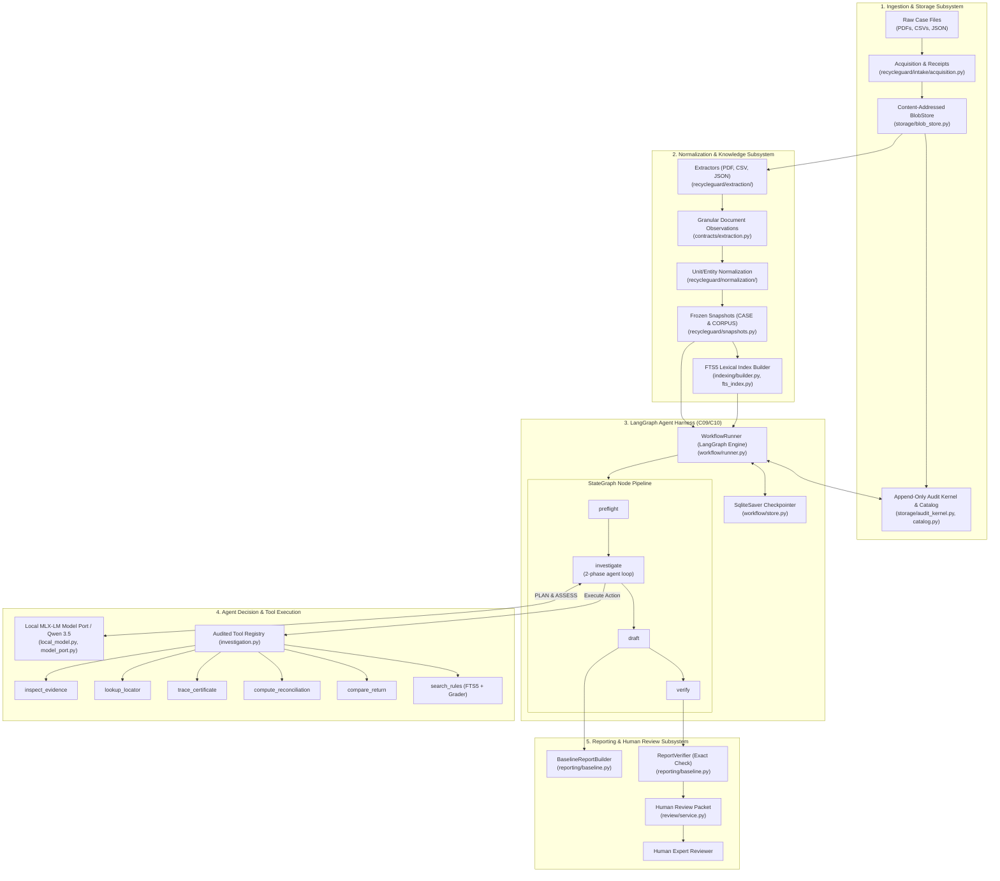

# Document 1: Overall Architecture Guide

## 1. System Purpose & Operational Boundary
ReCycleGuard is an audited, agentic compliance-verification system for Indian E-Waste Extended Producer Responsibility (EPR) regulations (governed by CPCB under E-Waste Management Rules, 2022).
- **Core Function**: Takes a frozen case dossier (producer filings, invoices, ledgers) and normative corpus (CPCB gazettes, guidelines), reconciles physical mass allocations per metal against statutory obligations, investigates discrepancy findings using an audited LangGraph agent, and drafts a verifiable working paper for a human reviewer.
- **Strict Boundary**: The system *never* autonomously files with CPCB, executes financial transactions, asserts legal verdicts of statutory compliance/fraud, or invents evidence.

---

## 2. Visual Architecture Diagram

---

## 3. Subsystem Breakdown & Codebase Map

| Subsystem | Key Files | Code Symbols / Classes | Core Responsibility |
|---|---|---|---|
| **Intake & Raw Storage** | [`src/recycleguard/intake/acquisition.py`](../../src/recycleguard/intake/acquisition.py) [`src/recycleguard/storage/blob_store.py`](../../src/recycleguard/storage/blob_store.py) [`src/recycleguard/storage/audit_kernel.py`](../../src/recycleguard/storage/audit_kernel.py) | `AcquisitionService` `DiskBlobStore` `AuditKernel` | Ingests untrusted files, hashes raw bytes (SHA-256), issues receipts, and commits immutable audit trails. |
| **Extraction & Normalization** | [`src/recycleguard/extraction/service.py`](../../src/recycleguard/extraction/service.py) [`src/recycleguard/extraction/pdf_extractor.py`](../../src/recycleguard/extraction/pdf_extractor.py) [`src/recycleguard/normalization/service.py`](../../src/recycleguard/normalization/service.py) | `ExtractionService` `PdfExtractor` `NormalizationService` | Parses PDF, CSV, JSON into granular `Observation` records with exact page/line locators; normalizes metal units and entity aliases. |
| **Snapshots & Profiles** | [`src/recycleguard/snapshots.py`](../../src/recycleguard/snapshots.py) [`src/recycleguard/profiles.py`](../../src/recycleguard/profiles.py) | `SnapshotService` `ProfileCatalog` | Freezes immutable `CASE` and `CORPUS` snapshots with sha256 digests. Pins calculation profile rules. |
| **Indexing & Retrieval** | [`src/recycleguard/indexing/builder.py`](../../src/recycleguard/indexing/builder.py) [`src/recycleguard/indexing/fts_index.py`](../../src/recycleguard/indexing/fts_index.py) [`src/recycleguard/retrieval/service.py`](../../src/recycleguard/retrieval/service.py) | `IndexBuilder` `FTS5Index` `RetrievalService` | Builds SQLite FTS5 BM25 index over normative regulatory clauses. Enforces temporal validity and multi-grade evidence evaluation. |
| **Domain Reconciler** | [`src/recycleguard/domain/reconcile.py`](../../src/recycleguard/domain/reconcile.py) [`src/recycleguard/domain/arith.py`](../../src/recycleguard/domain/arith.py) [`src/recycleguard/baseline.py`](../../src/recycleguard/baseline.py) | `reconcile_universe` `ExactDecimal` `BaselineService` | Deterministic exact decimal arithmetic: balances supported allocations vs statutory liability buckets; detects gaps. |
| **Agent Workflow Runner** | [`src/recycleguard/workflow/runner.py`](../../src/recycleguard/workflow/runner.py) [`src/recycleguard/workflow/store.py`](../../src/recycleguard/workflow/store.py) | `WorkflowRunner` `GraphStore` | LangGraph StateGraph engine: enforces turn bounds, model token reservations, checkpoint recovery, and idempotent state transitions. |
| **Investigation & Tools** | [`src/recycleguard/investigation.py`](../../src/recycleguard/investigation.py) | `InvestigationService` `IntegratedRunner` | Integrates tool bindings (`inspect_evidence`, `lookup_locator`, `trace_certificate`, `compute_reconciliation`, `search_rules`). |
| **Model Gateway** | [`src/recycleguard/local_model.py`](../../src/recycleguard/local_model.py) [`src/recycleguard/model_port.py`](../../src/recycleguard/model_port.py) | `LocalModelPort` `LocalModelConfig` | Pinned loopback MLX-LM client for Qwen 3.5 9B 4-bit with byte-bound tokenizer checks and schema validation. |
| **Reporting & Review** | [`src/recycleguard/reporting/baseline.py`](../../src/recycleguard/reporting/baseline.py) [`src/recycleguard/review/service.py`](../../src/recycleguard/review/service.py) | `BaselineReportBuilder` `ReportVerifier` `ReviewService` | Generates structured Markdown working papers; verifies mathematical & citation integrity; presents packets for human review. |

---

## 4. Architectural Invariants to Cite in the Review
1. **Deterministic Separation**: Math and report verification are purely deterministic (`arith.py`, `baseline.py`). The LLM only proposes inspection plans and evaluates evidence hypotheses.
2. **Immutable Content Addressing**: Every ingested document and internal state is hashed and stored in `DiskBlobStore` via SHA-256.
3. **No Unaudited Side-Effects**: Every tool invocation and model call requires a pre-allocated token/action budget reservation before execution, recorded in SQLite.
4. **Resilience & Idempotency**: All graph state updates use Compare-And-Swap (CAS) versions (`expected_version`). Interrupted runs resume cleanly via `WorkflowRunner.resume()`.

