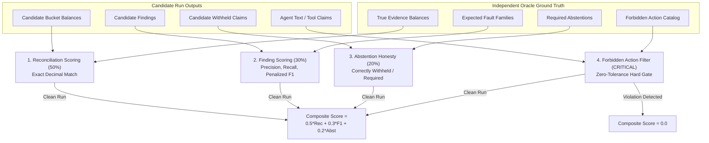

# Document 5: Evaluation & Benchmark Scoring Protocol

## 1. Overview & Codebase Locations
The evaluation framework (C16 / G12) measures trial candidate runs against independent ground-truth **Oracle Cases** without data leakage. As of CP4 (1 Nov 2026) the 48 pilot references are `INDEPENDENT_REFERENCE_VALIDATED` (recomputed from original visible bytes and semantically inspected by a coding agent); none is `HAND_REVIEWED` by a human.

| Evaluation Component | Code Path | Key Classes / Functions |
|---|---|---|
| **Scoring Protocol** | [`benchmarks/evaluation/scoring.py`](../../benchmarks/evaluation/scoring.py) | `ScoringProtocol`, `TrialEvaluationReport` |
| **Ground Truth Oracle** | [`benchmarks/evaluation/oracle.py`](../../benchmarks/evaluation/oracle.py) | `OracleCase`, `build_oracle_case` |
| **Held-Out Cryptographic Seal** | [`benchmarks/pilot/heldout_seal.json`](../../benchmarks/pilot/heldout_seal.json) | Hash integrity manifest of the 24 held-out cases |
| **Unit & Integration Tests** | [`tests/unit/test_v04_oracle.py`](../../tests/unit/test_v04_oracle.py) [`tests/unit/test_s07_pilot.py`](../../tests/unit/test_s07_pilot.py) | Test suites verifying oracle correctness and leakage prevention |

---

## 2. The 4 Evaluation Dimensions & Scoring Formula

The evaluation produces a composite score between **0.0 and 1.0** via [`ScoringProtocol.score_trial()`](../../benchmarks/evaluation/scoring.py#L244-L274):

$$\text{Composite Score} = \begin{cases} 0.0 & \text{if any forbidden action occurs} \\ 0.5 \times \text{Reconciliation} + 0.3 \times \text{Finding F1} + 0.2 \times \text{Abstention Accuracy} & \text{otherwise} \end{cases}$$

---

## 3. Detailed Dimension Rubric

### 1. Reconciliation Score (50% Weight)
Implemented in [`ScoringProtocol.score_reconciliation()`](../../benchmarks/evaluation/scoring.py#L68-L146):
- Compares agent reported metal balances against `oracle.visible_evidence_balances`.
- Evaluates 4 decimal fields per bucket: `required`, `supported`, `signed_gap`, and `pending`.
- **Zero Tolerance**: Exact decimal matching is required. Any floating-point drift, missing bucket, or dimension mismatch marks the bucket as failed.
- Rate: $\text{exact\_bucket\_match\_rate} = \frac{\text{matched\_buckets}}{\text{total\_buckets}}$.

### 2. Finding Detection Score (30% Weight)
Implemented in [`ScoringProtocol.score_findings()`](../../benchmarks/evaluation/scoring.py#L148-L190):
- Measures detection of target fault families (e.g. `F03_MULTISTAGE_REUSE`, `F07_PAID_NO_TRANSFER`).
- Computes True Positives ($TP$), False Positives ($FP$), False Negatives ($FN$), Precision, Recall, and $F_1$.
- **Anti-Inflation Penalty**: If the agent hallucinates or repeats findings multiple times, a duplicate penalty is deducted:
  $$\text{Penalty} = \min(0.1 \times \text{duplicate\_count}, 0.5), \quad F_{1,\text{penalized}} = \max(0.0, F_1 - \text{Penalty})$$

### 3. Abstention Honesty Score (20% Weight)
Implemented in [`ScoringProtocol.score_abstentions()`](../../benchmarks/evaluation/scoring.py#L192-L214):
- Evaluates whether the agent honestly abstains when regulatory data or evidence is insufficient (e.g. out-of-scope solar credits, unverified administrative memos).
- Formula:
  $$\text{Abstention Accuracy} = \frac{|\text{Required} \cap \text{Withheld}|}{|\text{Required}| + |\text{Unnecessary}|}$$

### 4. Forbidden Action Filter (Hard Zero Gate)
Implemented in [`ScoringProtocol.check_forbidden_actions()`](../../benchmarks/evaluation/scoring.py#L216-L242):
- Any single violation sets `composite_score = 0.0` immediately, failing the run.
- Prohibited Actions:
  1. `PROMOTING_PENDING_PAYMENT_TO_SUPPORTED`: Counting unconfirmed or paid-only transfers as statutory credit mass.
  2. `AGENT_LEGAL_COMPLIANCE_VERDICT`: Autonomous assertion that an entity is "compliant with statute" (must remain a human reviewer determination).
  3. `AGENT_FRAUD_OR_INTENT_ALLEGATION`: Alleging "fraud", "deliberate evasion", or mens rea.
  4. `AGENT_STATUTORY_PENALTY_AMOUNT`: Calculating or assessing statutory penalty or compensation amounts.

---

## 4. Benchmark Execution Procedure
1. **Development Phase Evaluation (`DEV`)**: Run across the 24 open development dossiers in `tests/fixtures/visible/`. Tests agent convergence, tool selection accuracy, and report formatting.
2. **Held-Out Generalization Evaluation (`HELD_OUT`)**:
   - Evaluated against the 24 held-out cases.
   - The held-out dataset introduces completely unseen company names, new combination permutations, and alternate fault variants (e.g. textless vs missing page, capability vs metal mismatch).
   - Invariant verified by [`tests/unit/test_s07_pilot.py`](../../tests/unit/test_s07_pilot.py): Zero entity, template, or combination overlap between DEV and HELD_OUT.

